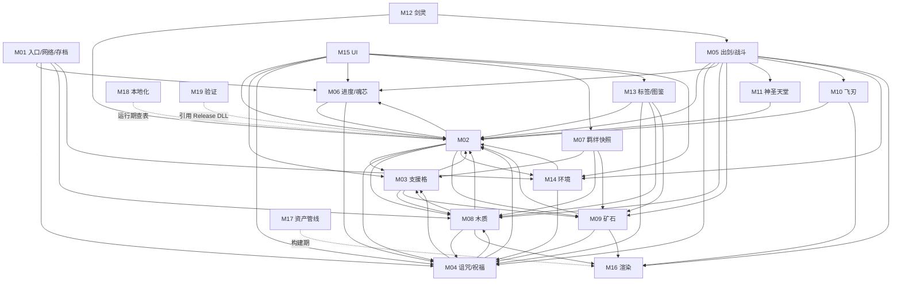

# 天顶复苏 · 诅咒残魂 — 架构总览

> 基线 `ZenithReborn/build.txt` = `0.3.132`。本文的 `文件:行号` 均对照当前工作区源码核验；未核验处只写文件名。
> 事实来源：`docs/CODEBASE_MAP.md`（19 模块总图）+ `artifacts/codebase-map/{A,B,D,E}-*.md`。
> 阅读顺序建议：先看 §1 边界表定"该改谁"，再看 §2 数据流定"改在哪一行"，§5/§6 用于评估爆炸半径。

---

## 1. 模块边界表

M01 是 CODEBASE_MAP §0/§1 之外补入的"入口层"（`ZenithReborn.cs`），其余 M02–M19 与 CODEBASE_MAP §2–§19 一一对应。

| # | 模块 | 负责什么 | 不负责什么（边界） | 核心文件 |
|---|---|---|---|---|
| M01 | 模组入口 / 网络 / 存档 | `Mod.Load` 注册键位、`HandlePacket` 唯一分派、`SoulItem.SaveData/LoadData` | 不解释包体语义（全部下沉到各 `Receive*`）；不做校验以外的业务 | `ZenithReborn.cs`、`SoulItem.cs:307` 区块 |
| M02 | 剑魂数据 / 槽位引擎 | 5 组槽位数组、槽号映射、`Active`/`Supports`/容量/效力/射程、`TrySwapHost`、`RefreshStats` | 不决定"打多少伤害"（在 `SoulCombat.BladeDamage`）；不画 UI | `SoulItem.cs`、`SoulCombat.cs` |
| M03 | 支援格引擎 | 族门槛 → 支援格数的**不动点求解**、`SetItems`/`FamilyItems`/`GrantedBy` | 不判定某个 Item 属于哪族（只调 `WoodTypes`/`OreFamily` 的 Mask） | `SoulSupport.cs` |
| M04 | 诅咒 / 祝福 / 难度 | 18 位铭刻 → 四档等级 → 出剑数/命中期/穿地深度；御剑爆发；`SoulDifficulty.Toggle` | 不写 `Seals`（唯一写入方是 `SoulBossCredit.OnKill`）；不改槽位容量 | `SoulCurses.cs`、`SoulBlessings.cs`、`SoulEchoDamage.cs`、`SoulDifficulty.cs` |
| M05 | 出剑与战斗 | 挥臂→发射预算→`SoulBlade` 运动学/剑影/命中单元/五族扇出/特技 | 不持有族数据（只调各族 `OnMainHit`）；不画最终像素（交给 M16） | `SoulSwingPlayer.cs`、`SoulBlade.cs`、`WeaponFamilies.cs` |
| M06 | 进度 / 魂芯 / 解锁 | 12 位击杀掩码 + 6 枚魂芯 → 10 槽；参与记录、补办、附着叙事、月总修复 | 不负责 18 位诅咒位（那是 `Seals`，两套映射） | `Progression.cs`、`SlotProgression.cs`、`SoulBossUnlocks.cs`、`AttachmentStory.cs`、`LunarSummonRecovery.cs` |
| M07 | 羁绊快照 | 数量→阶段→进度→颜色的**只读**展示模型，供核心环/木质面板/详情页共用 | 不参与战斗数值；不写任何状态 | `BondSnapshot.cs` |
| M08 | 族·木质 | 8 木剑的 S 倍率/生命、8 条命中补丁、森林之力、圣林归冠、三组复合羁绊 | **不产生弹幕**，全部挂在既有 `SoulBlade` 与 DoT 通道上 | `WoodTypes.cs`、`WoodCombat.cs`、`WoodPlayer.cs`、`ForestPower.cs`、`WoodCrown.cs`、`WoodBond*.cs` |
| M09 | 族·矿石 | 14 材质 22 把，按材质去重；首击集结环阵齐射；6 条肉后连击；14 材质奖励位 + 天空落剑 | 不把 `HardOreTypes`（6 把）当族名册 | `OreFamily.cs`、`OreFlyingSword.cs`、`OreSkyfall.cs`、`HardOrePlayer.cs` |
| M10 | 族·飞刃 | 31 把剑按 0.3s/把蓄能，挥臂一次性掷出并**取代**本体飞剑 | 弹幕不带 `SoulId`，故**不进任何祝福/环境/矿石/木质管线** | `FlyingBladeFamily.cs`、`FlyingBladeHand.cs`、`FlyingBladeShot.cs` |
| M11 | 族·神圣天堂 | 8 把剑中任一把在 `TraitItems` → 主击 300 帧冷却落星（`StarDamage=1000` 常量） | 不吃任何伤害倍率 | `HolyHeavenFamily.cs`、`HolyHeavenProc.cs`、`HolyHeavenStar.cs` |
| M12 | 族·剑灵 | 为每个出战主攻槽生成隐形召唤体，伪造 `Player.ItemCheck()` 代打 | 召唤体本身 `CanDamage()=>false` | `LivingArmamentFamily.cs`、`LivingArmamentPlayer.cs`、`LivingWeaponProxy.cs`、`LivingProxyOwnerState.cs`、`LivingChannelProjectile.cs` |
| M13 | 族标签 / 特性图鉴 | `WeaponFamilyTags.Of` 是"武器属哪些族"的**唯一展示出口**；`SoulTraits.All` 生成图鉴条目 | 不参与战斗判定；`Active` 多为手写复算，与战斗侧是两份代码 | `WeaponFamilyTags.cs`、`SoulTraits.cs` |
| M14 | 环境属性 | 21 环境（与族**正交**）、武器静态绑定、收集位图、常驻名额、21 条机制 | 只"收集"不给机制；机制要求祝福/领域/自然三级判定通过 | `EnvironmentAttributes.cs`、`EnvironmentRules.cs`、`EnvironmentPlayer.cs` |
| M15 | UI 层 | 全屏魂域：配阵/图鉴/成长/环境/旧物；点击隔离；预览克隆 | 不写战斗数值；`DomainMode` 恒 true，浮窗路径为休眠代码 | `SoulUI.cs` + 17 个 `SoulUI*.cs`、`SoulArmoryLayout.cs`、`SoulInput.cs` |
| M16 | 渲染与特效 | 分支总闸、拖尾/剑体/星芒/玻璃折射/表面材质、逐项调试热键 | 不决定"生不生效"（那是 M04/M05/M08-M14）；不读档 | `VfxIsolation.cs`、`SoulVisuals.cs`、`SoulMaterialTrail.cs`、`SoulSceneRefraction.cs` |
| M17 | 资产与材质管线（构建期） | `VfxLibrary` → 贴图/常量类/着色器；包审计 | **运行时不读 `VfxLibrary`**；生成文件禁手工改 | `checks/emit_*.py`、`checks/compile_effects.py`、`VfxMaskData.cs` |
| M18 | 本地化 | `Items/Buffs/NPCs/Projectiles/Keybinds` 五类 hjson | **不含界面文案**（硬编码在 `.cs`） | `Localization/zh-Hans.hjson`、`en-US.hjson` |
| M19 | 验证体系 | 独立附属模组 `ZenithPrototypeCheck` + 58 py / 39 ps1；服务端夹具 | `-server` 无 GPU，26 个渲染夹具直接 return；真实多人零覆盖 | `checks/ZenithPrototypeCheck/Check.cs`、`checks/*.py`、`checks/*.ps1` |

---

## 2. 三条端到端数据流

### 2.1 战斗链路（挥臂 → 各族派发）

```
Player.ItemCheck
 → SoulItem.CanUseItem (SoulItem.cs:371)          守卫：!Attached 或 Active 为空则不出剑
 → SoulSwingPlayer.Begin (SoulSwingPlayer.cs:16)   选主攻；budget = min(hosts, SoulCurses.Blades)；归鞘打断
 → WeaponFamilies.Of (WeaponFamilies.cs:18)        判族：木质/矿石先短路返回 Plain
 → SoulCombat.BladeDamage (SoulCombat.cs:9)        加伤：GetWeaponDamage × Potency × OreFamily.MainDamageMultiplier
 → SoulItem.EmitBlade (SoulItem.cs:444)            生成 SoulBlade，写 SoulSource 四字段
 → SoulSource.OnSpawn (SoulBlade.cs:38)            身份继承：SoulId / SourceWeapon / PrimaryOrdinal / HostSlot
 → SoulBlade.AI (SoulBlade.cs:171)                 椭圆轨迹 + trailCenters 历史 + SoulTerrain.Sweep 穿地
 → SoulBlade.ModifyHitNPC (SoulBlade.cs:333)       剑影倍率 SoulEchoDamage.Multiplier + WoodCombat.ModifyPrimaryHit
 → SoulBlade.OnHitNPC (SoulBlade.cs:294)           五族唯一扇出点（隐式优先级链，无事件总线）
     ├→ WoodCombat.FinishPrimaryHit (WoodCombat.cs:70) → WoodBond{Crown,Forge,Rot,Ember} 派发
     ├→ HardOrePlayer.Hit → OreFamily.OnMainHit (OreFamily.cs:116)      环阵齐射
     ├→ HolyHeavenProc.OnMainHit (HolyHeavenProc.cs:14)                300 帧冷却落星
     └→ EnvironmentPlayer.Hit / BlessingPlayer.Hit                      环境乘区 / 祝福接刀
 → SoulBossCredit.ModifyHitByProjectile (Progression.cs:124)           客户端发 packet 8
```

计数与加伤不在同一条线上：`SoulSupport.FamilyItems`（`SoulSupport.cs:43`）= `Active ∪ Supports`，五族计数全部由它派生；伤害只看 `BladeDamage` + `MainDamageMultiplier`。

### 2.2 UI 链路（开剑魂 → 改槽位 → 同步）

```
P 键 / 键位 → SoulUI.Toggle (SoulUI.cs:46)
 → SoulUI.ModifyInterfaceLayers (SoulUI.cs:102)   插 Input Shield + Soul 层；域模式删 Vanilla:*
 → SoulUI.PostUpdateInput (SoulUI.cs:75)          P 关闭 / 死亡 / 背包无此魂 → 自动关
 → SoulInput.Capture (SoulInput.cs:20)            屏蔽世界输入
 → SoulUI.Draw (SoulUI.cs:341) → 页面分发 (:382)
 → SoulUIArmory.DrawArmory (SoulUIArmory.cs:9)    读 SoulItem.Active / ItemAt / VisibleSlotIds / BondSnapshot
 → 命中 SoulUI.SlotBounds (SoulUI.cs:211) → SoulArmoryLayout.Slot (SoulArmoryLayout.cs:31)
 → SoulDomainUI.SelectSlot (SoulDomainUI.cs:32) → EquipFromInventory (SoulDomainUI.cs:44)
 → SoulItem.TrySwapHost (SoulItem.cs:95)          全模组唯一寄宿写入口：容量/封印/CanHost/同种去重
 → SoulItem.RefreshStats (SoulItem.cs:387)        不调则一切面板派生值陈旧
 → SoulUI.Sync (SoulUI.cs:56)                     仅 MultiplayerClient 生效；物品落盘走 Item.SaveData
 → SoulInput.EndSoulLayer (SoulInput.cs:54) → RestoreAfterInterface (:61)
```

### 2.3 构建链路（改源码 → 安装）

```
改 *.cs / Assets
 → checks/check_mod_assets.py          闸门 1：新增 Mod 类型无贴图/无 override（服务端永远看不见，必须离线拦）
 → checks/emit_glass_preset.py         生成 GlassMaterialPreset.cs（13 参数上下界 + scope 断言）
 → checks/compile_effects.py           闸门 2：.fx → .fxc + build-manifest.json（包审计的哈希基准）
 → dotnet tModLoader.dll -server -build ×2   闸门 3：C# / hjson 语法；产物落 build-profile/Mods/*.tmod
 → 拷到 wood-check-profile/Mods + enabled.json=[两包] + ZENITH_WOOD=1
 → Check.PostAddRecipes (Check.cs:11)   夹具唯一总调度：读 ZENITH_CHECK_REPORT (Check.cs:34) 路由
 → artifacts/wood-check.txt  "PASS: <n> …"（失败则 keep 旧文件 + 抛异常）
 → checks/package_install.py           20 步校验：报告时序 / 包哈希三方一致 / 逐字节源码比对
 → artifacts/ZenithReborn-<ver>.tmod + artifacts/install-result.json（73 键）+ Mods/ZenithReborn.tmod
```

---

## 3. 模块级依赖方向

只画"谁直接调谁"，不画到函数级；`M15 UI` 与 `M16 渲染` 是纯消费方（无业务反写）。



---

## 4. 共享状态与单一入口

改这些点等于同时改多个模块的行为，必须当成 API 对待。

| # | 单一入口 / 共享状态 | 位置 | 谁在派生（只读消费） |
|---|---|---|---|
| 1 | `SoulItem.Active` — **全模组最敏感的数据出口** | `SoulItem.cs:82` | `SoulSupport.FamilyItems`、`SoulCurses.TraitMains/CombatWood`、`OreFamily.OreItems/Count`、`FlyingBladeFamily`、`HolyHeavenFamily`、`EnvironmentRules.RegisterEnvironments`、`BondSnapshot.Wood`、`SoulTraits`、`SoulSwingPlayer.Begin` |
| 2 | `SoulSupport.FamilyItems` — 族计数**唯一入口** | `SoulSupport.cs:43` | 木质 `WoodTypes.Mask`、矿石 `OreItems`、`CombatWood`、`BondSnapshot.Wood`、`EnvironmentRules` 收集位 |
| 3 | `VfxIsolation` — 唯一特效总闸 | `VfxIsolation.cs:8` | 所有 `Vfx*`/`Soul*` 绘制入口。`Branches` 10 项（`:63`）真生效；`Parts` P01–P26（`:107`）+ `GlassParts` 7 项（`:226`）共 **33 项是空开关**：`PartValue`（`:141`）全库零调用、shader 无 `uPart`/`uGlassPart` uniform |
| 4 | `SoulSource` — 跨模块身份总线 | `SoulBlade.cs:14`，字段 `:17-21` | `BlessingPlayer.ValidSource`、`WoodBondHit`、`SoulBossCredit`、`FlyingBladeFamily`、`EnvironmentPlayer` |
| 5 | `ZenithReborn.HandlePacket` — 唯一网络入口 | `ZenithReborn.cs:18` | **action 1–12 已全部占用**：1/7 附着、2 推进、3 木质特性、4 森林成长、5 魂芯、6 史莱姆王对白、8 Boss 授勋、9 月总修复、10 祝福、11 环境命中、12 木质 A/B/C 中继。新增同步必须开 13+ |
| 6 | `Check.cs` — 夹具唯一总调度 | `checks/ZenithPrototypeCheck/Check.cs:11` | 环境变量路由：`:34` 读 `ZENITH_CHECK_REPORT`（空则整体退出）、`:38-170` 十几个 `ZENITH_*` 分支、`:125` `ZENITH_WOOD` 串 29 套件、`:15` `Assert` 快速失败 |
| 7 | `SoulItem.TrySwapHost` — 唯一寄宿写入口 | `SoulItem.cs:95` | UI 点击 / `SoulArmoryPreview`（克隆后试算，不写回）/ 网络接收 |
| 8 | `SoulArmoryLayout.Slot` — UI 与点击判定的唯一共享几何源 | `SoulArmoryLayout.cs:31` | `SoulUI.SlotBounds`（`SoulUI.cs:211`）、`SoulItem.SupportOrdinal`（`:28`）必须同口径 |

---

## 5. 跨模块依赖矩阵

`✓` = 存在直接调用/读写；`—` = 无直接依赖（可能经 UI 或网络间接）。

| 调用方 ＼ 被调用方 | M03 支援 | M04 诅咒 | M05 战斗 | M06 进度 | M07 羁绊 | M08 木质 | M09 矿石 | M14 环境 | M15 UI | M16 渲染 | M01 入口 |
|---|---|---|---|---|---|---|---|---|---|---|---|
| M02 剑魂数据 | ✓ | ✓ | ✓ | ✓ | — | ✓ | ✓ | ✓ | — | — | — |
| M03 支援格 | — | ✓ | — | — | — | ✓ | ✓ | — | — | — | — |
| M04 诅咒/祝福 | ✓ | — | — | ✓ | — | ✓ | — | — | — | — | — |
| M05 出剑/战斗 | — | ✓ | — | ✓ | — | ✓ | ✓ | ✓ | — | ✓ | — |
| M06 进度/魂芯 | — | ✓ | — | — | — | — | — | — | — | — | ✓ |
| M07 羁绊快照 | ✓ | — | — | — | — | ✓ | ✓ | — | — | — | — |
| M08 木质 | ✓ | ✓ | ✓ | — | — | — | — | — | — | ✓ | — |
| M09 矿石 | ✓ | ✓ | ✓ | — | — | — | — | — | — | ✓ | — |
| M10 飞刃 | — | ✓ | ✓ | — | — | — | — | — | — | ✓ | — |
| M11 神圣天堂 | — | ✓ | — | — | — | — | — | — | — | ✓ | — |
| M12 剑灵 | — | — | ✓ | — | — | — | — | — | — | — | — |
| M13 标签图鉴 | — | ✓ | — | — | — | ✓ | ✓ | ✓ | — | — | — |
| M14 环境 | — | ✓ | — | — | — | — | — | — | ✓ | — | ✓ |
| M15 UI | ✓ | ✓ | — | ✓ | ✓ | ✓ | ✓ | ✓ | — | — | — |
| M16 渲染 | — | — | ✓ | — | — | — | — | ✓ | — | — | — |

---

## 6. 典型修改的影响范围

| # | 改动 | 波及模块 | 必须同步改哪里 |
|---|---|---|---|
| 1 | 改 `SoulItem.Active` 组成（`SoulItem.cs:82`） | M03/M04/M07/M08/M09/M10/M11/M13/M14/M15 | 伤害均值与射程、六套族计数、`BondSnapshot.Wood`、`SoulTraits` 判定、`EnvironmentRules` 收集位全部同时变；必须跑 `ZENITH_WOOD` 全回归（29 套件） |
| 2 | 改族判定（`WeaponFamilies.Of` / `WoodTypes.Types`） | M05/M08/M13/M14 | `WeaponFamilies.cs:18` 的木质/矿石**先短路**再看表，顺序一改手感剧变；`WeaponFamilyTags.Of`（`:10`）固定五段顺序；`EnvironmentAttributes.RegisterBuiltins`（`:87`）是另一张独立表，不会自动跟随 |
| 3 | 加新族武器 | M08 或 M09 + M13 + M14 + M17 | 名册表（`WoodTypes.Types` / `OreFamily.MaterialSwords`）→ `WeaponFamilyTags.Of` → 环境绑定表 → 本地化 `Items` → 若有新贴图还要过资产闸门；矿石另需同步 `DefaultType/Names/Tints`、`AllMaterials` 位宽、`OreCollectionMask` 存档语义 |
| 4 | 加新特效分支 | M16 + M17 + M18 | `VfxIsolation.Branches`（`:63`，**只有这 10 项真生效**）→ 消费点绘制函数 → `VfxPartDebug` 的 F9 清单（若加 Parts 只会得到空开关）→ 若新增 .fx 必须进 `build-manifest.json`，否则包审计 `check_vfx_ownership.py` 的"集合恰好相等"会失败 |
| 5 | 改本地化 / 界面文案 | M18 或 M15 | **物品名/提示改 hjson；界面文字改 `.cs`**（`SoulUIPages.Name` 等全硬编码）。中文 Projectiles 仍缺 `FlyingBladeShot`/`HolyHeavenStar`/`HolyHeavenImpact`/`LivingArmament`/`EnvironmentEffect`/`EnvironmentDomain` 6 条 |
| 6 | 改槽号（34 / 35-36 / 17-24） | M02/M07/M15 + 存档 | `ItemAt`、`SlotItems`、`VisibleSlotIds`、`SoulArmoryLayout.Slot`、`SlotBounds`、`SoulUIEffects` 六处同改；17-24 是存档兼容段，**不可回收** |

---

## 7. 已知硬坑（一行式）

- **木质族三套并行口径**：`SoulCurses.cs:87`（`CombatWood`，受 `TraitEnabled` 过滤）、`SoulSupport.cs:43`（`FamilyItems`，不过滤）、`BondSnapshot.cs:63`（UI 走这条）→ 改一处必须三处同改，否则"同屏不同值"。
- **`VfxIsolation` 的 33 项是空开关**：`Parts` P01–P26 + `GlassParts` 7 项，按 F9 只改面板文字、画面零变化（`PartValue` 零调用、shader 无对应 uniform）；只有 `Branches` 10 项真生效。
- **`OreFamily.Count` 与 `SoulSupport.GrantedBy` 对传奇位态度相反**：计数含传奇位（`OreFamily.cs:91` 走 `Active`），授予不含（`SoulSupport.cs:45` 走 `SetItems`）—— 刻意的，防传奇位白送支援格。
- **`FlyingBladeShot` 不携带 `SoulId`**（`FlyingBladeHand.cs:31` 注释），所以飞刃不吃祝福/环境/矿石/木质命中管线，只吃 `BladeDamage × DamageBonus`。
- **`PureCodeOnly` 是表达式不是字段**（`VfxIsolation.cs:12`），不可运行时切换；改 true 会一次关掉 12 个外部输入分支 + 全部贴图加载 + 滤镜。
- **`ViscousSlash` 绕过总闸**（`VfxIsolation.cs:36`），不在 61 项清单里，只能改字段关。
- **`SlotGates` 是存档契约**（`SlotProgression.cs:12`）：中间插删直接改老档 `Capacity`。
- **两套 Boss 位映射**：`SoulCurses.BossSeal`（18 位）vs `SoulProgress.BossBit`（12 位）；`Queen/Empress/Duke/Deer` 只在诅咒位存在 —— 打它们只解诅咒、不给槽位。
- **`SoulBlade` 服务端/客户端必须走同一 `trailCenters` 分支**（`SoulBlade.cs:244` 附近），否则"看得见打不到"。
- **剑灵代理临时上下文**：`LivingWeaponProxy.Tick` 使用 `[ThreadStatic] Current` 并临时设置鼠标；`LivingChannelSystem` 在已绑定代理弹幕的原版 AI 和近战视线检查期间临时替换 `Main.player[owner]`。这些窗口必须 `finally` 恢复。直接 ItemCheck 消费招架时同步清除真人状态；弹幕伤害嵌套消费仍需验证。玩家状态只复制已声明字段，不代表全部第三方状态已兼容。
- **夹具引的是 Release DLL**（`ZenithPrototypeCheck.csproj` HintPath）：不重建主模组就静默测旧逻辑。
- **`CurseFixture.NeutralDefaults` 是全局毒开关**：默认 false = 新魂带全六诅咒，`TraitItems` 只返回第一把主攻 → 多剑类断言集体假阴性。
- **`package_install.py` 时序断言**：`wood-check.txt` 的 mtime 必须晚于 `.tmod`；任何重建包都会让它失败。
- **界面文案在 `.cs`、物品文案在 hjson**，两处不要混改。
